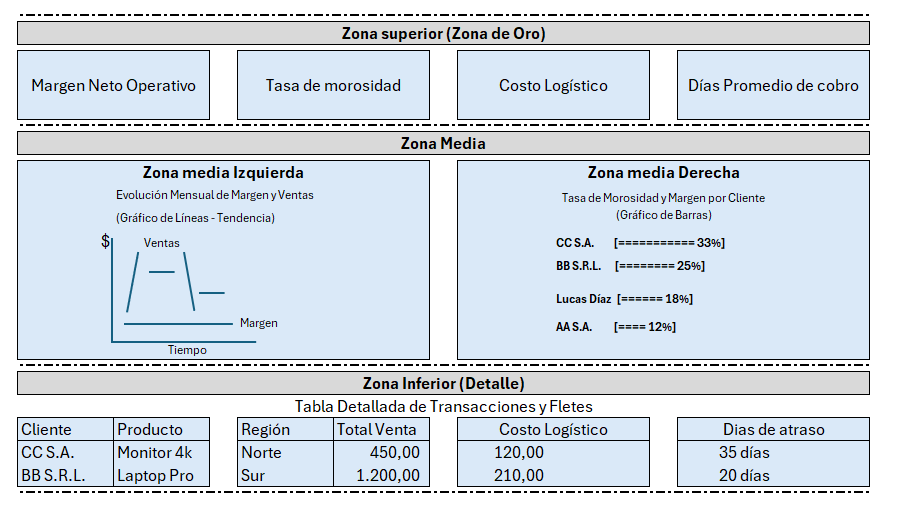

# 🛒 Proyecto Integrador - RetailPro por Maximiliano Fenaroli

## 📝 Descripción del Proyecto y Problemática
En muchos negocios de retail, la alta rotación de inventario y el volumen de ventas enmascaran problemas estructurales de rentabilidad. RetailPro aborda esta problemática mediante el modelado de datos, análisis de negocio (BI) y procesos ETL para optimizar la toma de decisiones comerciales.

## 🛠️ Herramientas y Tecnologías Utilizadas
- **Base de Datos:** Microsoft SQL Server (T-SQL)
- **Visualización / Dashboard:** Power BI (Archivo ejecutable: `Fenaroli_Maximiliano_Checkpoint2.pbix`)
- **Lenguaje:** SQL (DDL, DML, CTEs, Joins)

## 📂 Archivos Principales del Repositorio
- `m5_consultas_joins.sql`: Consultas de análisis exploratorio y uniones.
- `Fenaroli_Maximiliano_Checkpoint2.pbix`: Dashboard interactivo con Zonas de Oro y KPIs.
- `Pipeline_ETL_FENAROLI_MAXIMILIANO.pbix`: Archivo con el tratamiento de datos.

---

*(A partir de acá comienza la documentación técnica detallada por módulo)*

Justificación Técnica - Pipeline ETL
Tratamiento de valores nulos: se decide reemplazar los "null" dentro de las columnas con formato texto por "info pendiente" ya que eliminar estas filas implicaría perder transacciones de venta asociadas a estos clientes en la tabla Fact_Ventas
Tramiento de valores nulos en columnas de número: se decide reemplazarlos por ceros para preservar el tipo de dato numérico (decimal/entero) y evitar transformar la columna a formato texto.

# Proyecto Integrador - RetailPro

## Módulo 8: Boceto del Dashboard RetailPro
### Justificación del Diseño y Layout
Relación con la problemática: En el M1 se planteó que la empresa opera a máxima capacidad pero pierde dinero. Seleccioné estos gráficos porque contestan directamente las dudas que planteamos al principio sobre qué clientes se atrasan con los pagos, qué cosas estamos vendiendo a pérdida y cómo se nos drena el margen los gastos de transporte.
**Selección de KPIs para la Zona de Oro:**
- **Margen Neto Operativo (%):** Es el indicador planteado en el M1 para determinar la rentabilidad real tras descontar costos logísticos y de reposición.
- **Tasa de Morosidad (%):** Mide directamente la porción de facturación vencida que está drenando el capital de trabajo.
- **Costo Logístico sobre Ventas (%):** Evalúa el impacto de los fletes y mantenimiento de flota en la ganancia neta por territorio.
- **Días Promedio de Cobro:** Mide el tiempo financiero de recuperación de liquidez para detectar cuellos de botella en gestión de cobros.

**Selección de Gráficos:**
- **Gráfico de Líneas (Zona Media Izquierda):** Lo seleccioné para observar cómo se mueven las ventas y el margen mes a mes. La idea es detectar rápidamente en qué meses los gastos nos comieron la ganancia y terminamos a pérdida.
- **Gráfico de Barras Horizontales (Zona Media Derecha):** Sigue la misma idea que armé en el M1. Lo elegí porque es la mejor forma de ordenar las cosas y ver rápido quiénes son los peores pagadores o qué productos no convienen tanto.

**Resumen vs. Detalle:**
- **Resumen:** La zona superior y la zona media está pensada para que el directorio entienda dónde se nos está yendo el capital de trabajo.
- **Detalle:** La zona inferior es para poder notar rápidamente si es necesario o no analizar algún cobro puntual e investigar atrasos o proponer ajustes de precio.
---
